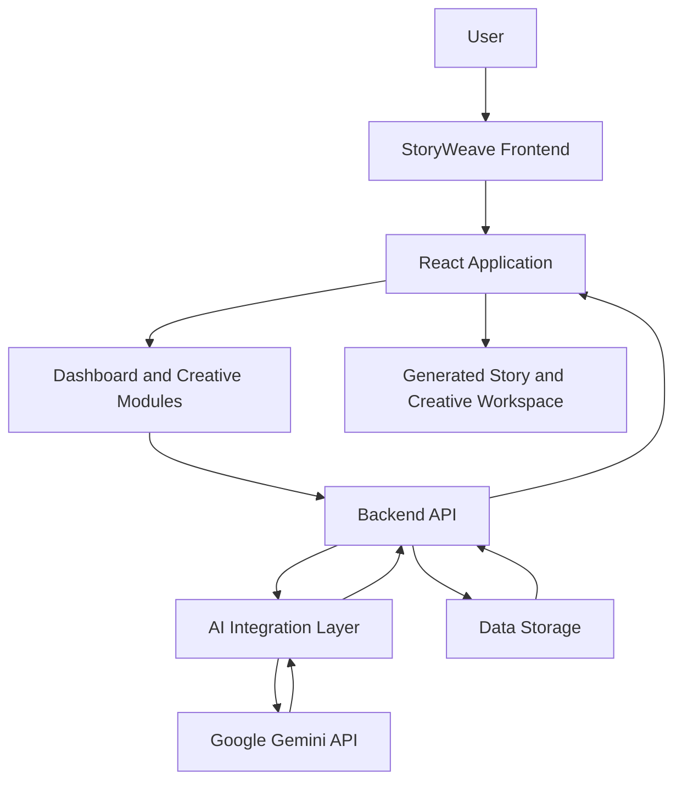
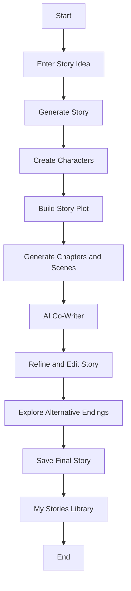
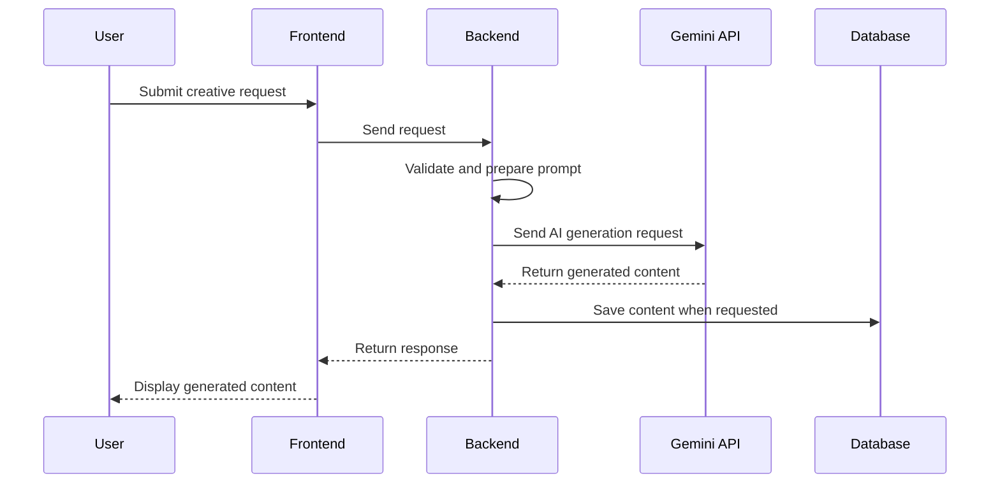

# ✨ StoryWeave
### Your Imagination. Our Intelligence. Infinite Stories.

<p align="center">
  <strong>An AI-Powered Storytelling & Creative Co-Writing Platform</strong>
</p>

<p align="center">
  Transform simple ideas into extraordinary stories with the power of artificial intelligence.
</p>

<p align="center">
  
  
  
  
</p>

<p align="center">
  <i>Where imagination meets intelligence, and every idea becomes a story waiting to be told.</i>
</p>

---

## 🌌 1. Introduction

**StoryWeave** is an AI-powered storytelling and creative writing platform designed to transform imagination into captivating narratives.

Writing a compelling story requires creativity, character development, structured storytelling and consistency. However, turning a simple idea into a complete narrative can sometimes be challenging.

StoryWeave aims to make this creative journey easier by bringing intelligent AI assistance into one unified writing environment.

Whether you are an aspiring novelist, a passionate storyteller, a student, or someone with an imaginative idea, StoryWeave acts as your personal creative partner.

From generating original stories and developing fictional characters to building intricate plots and refining individual scenes, StoryWeave helps bring your creative vision to life.

**Our mission is simple: Empower everyone to become a storyteller.**

## 🎯 2. Our Vision

We believe everyone has a story worth telling.

However, not everyone knows how to transform an idea into a compelling narrative.

StoryWeave bridges the gap between imagination and execution by combining human creativity with artificial intelligence.

Our vision is to create an intelligent storytelling ecosystem where users can:

- Turn simple thoughts into complete stories.
- Develop memorable fictional characters.
- Build meaningful and engaging storylines.
- Overcome writer's block with AI assistance.
- Experiment with different writing styles and narrative directions.
- Collaborate with AI throughout the creative process.

We don't want AI to replace human creativity. We want it to enhance it.

## ✨ 3. Key Features

### 📝 AI Story Generator

Transform a simple concept into an engaging narrative.

Users can provide a story idea and customize the generation process using different creative preferences.

**Features:**
- AI-powered original story generation.
- Multiple genres, including Fantasy, Mystery, Horror, Romance, Science Fiction and Adventure.
- Customizable writing tones.
- Different writing styles.
- Adjustable story lengths.
- Creative title generation.
- Story regeneration and editing.
- Save and manage generated stories.

### 🎭 Character Studio

Create detailed and memorable fictional characters.

Character Studio helps writers develop personalities, backgrounds and motivations that make stories more engaging.

**Features:**
- AI-powered character creation.
- Character names and descriptions.
- Personality development.
- Physical appearance descriptions.
- Character backgrounds and histories.
- Strengths and weaknesses.
- Character roles and relationships.
- Character editing and management.

### 📖 Interactive Plot Builder

Turn scattered ideas into structured narratives.

The Plot Builder helps users organize their stories into meaningful narrative stages.

**Story structure:**

1. Introduction – Introduce the setting and characters.
2. Inciting Incident – Introduce the event that starts the conflict.
3. Rising Action – Develop tension and complications.
4. Climax – Present the major turning point.
5. Falling Action – Explore the consequences.
6. Resolution – Bring the story to a meaningful conclusion.

**Features:**
- AI-assisted plot generation.
- Chapter organization.
- Scene creation.
- Editable plot sections.
- Character-based storytelling.
- Structured narrative development.

### 🤖 AI Co-Writer

Your intelligent creative writing companion.

The AI Co-Writer is designed to assist writers throughout their writing journey.

Instead of generating an entire story at once, users can work with AI paragraph by paragraph, scene by scene and chapter by chapter.

**Writing assistance:**
- Continue Writing.
- Rewrite Paragraph.
- Improve Grammar.
- Add Dialogue.
- Make Writing More Emotional.
- Change Writing Style.
- Expand Scenes.
- Summarize Narratives.

The goal is to provide contextual assistance while preserving the writer's original creative direction.

### 🔀 Alternative Story Endings

Explore multiple possibilities for the same story.

Generate different narrative conclusions and choose the one that best fits the creative vision.

**Ending styles:**
- Happy Ending.
- Sad Ending.
- Unexpected Twist.
- Open Ending.

### 📚 My Stories

A dedicated creative library for managing personal writing projects.

**Features:**
- Save stories.
- Browse previous projects.
- Edit existing stories.
- Search and filter stories.
- Organize creative work.
- Delete unwanted projects.
- Revisit unfinished narratives.

### 🎬 Cinematic Website Introduction

StoryWeave aims to deliver an immersive first impression through a cinematic opening sequence.

The planned animated experience includes:

- A mysterious universe of glowing particles.
- A magical book emerging from darkness.
- Floating letters and luminous story fragments.
- A cinematic StoryWeave logo reveal.
- An atmospheric brand tagline.
- A seamless transition into the landing page.

The visual identity combines storytelling aesthetics with futuristic AI-inspired design.

---

## 🎨 4. Design Philosophy

StoryWeave follows a premium dark-themed visual identity inspired by modern creative SaaS platforms.

Our design philosophy focuses on creating an immersive environment where users can concentrate on creativity without unnecessary distractions.

### Visual Identity

| Design Element | Description |
|---|---|
| Primary Theme | Dark Midnight |
| Primary Color | Violet Purple |
| Accent Color | Electric Blue |
| Background | Deep Midnight Black |
| UI Style | Modern Glassmorphism |
| Typography | Clean and Elegant |
| Animations | Smooth and Cinematic |
| Layout | Responsive and Minimal |

### Color Palette

| Color | Hex Code | Purpose |
|---|---|---|
| Midnight | `#0B0B14` | Main background |
| Deep Purple | `#121225` | Secondary background |
| Card Purple | `#19192D` | Cards and panels |
| Violet | `#8B5CF6` | Primary actions |
| Lavender | `#A78BFA` | Highlights |
| Indigo | `#6366F1` | Accent elements |
| White | `#F8FAFC` | Primary text |

---

## 🛠️ 5. Technology Stack

StoryWeave is designed around a modern web development architecture that combines frontend technologies, backend services and generative AI.

### Frontend Technologies

| Technology | Purpose |
|---|---|
| React.js | Building reusable UI components |
| TypeScript / JavaScript | Application logic and development |
| Tailwind CSS | Responsive styling and design |
| Lucide React | Modern interface icons |
| HTML5 | Application structure |
| CSS3 | Animations and visual effects |

### Backend Technologies

| Technology | Purpose |
|---|---|
| Node.js | Server-side JavaScript runtime |
| Express.js | Backend API development |
| REST APIs | Communication between frontend and backend |
| Environment Variables | Secure configuration management |

### Artificial Intelligence

| Technology | Purpose |
|---|---|
| Google Gemini API | AI-powered storytelling |
| Google AI Studio | AI experimentation and application development |
| Prompt Engineering | Structured creative generation |
| Context Management | Maintaining story and character continuity |

### Data Management

| Technology | Purpose |
|---|---|
| LocalStorage | Initial local persistence |
| Supabase (planned) | Cloud database and persistent storage |
| JSON | Structured application data |

### Development Tools

| Tool | Purpose |
|---|---|
| Google AI Studio | AI-assisted application development |
| Google Antigravity | Optional advanced AI-assisted development |
| Git | Version control |
| GitHub | Source code hosting and collaboration |
| GitHub Desktop | Beginner-friendly Git workflow |
| Google Chrome | Browser testing |

*Note: The exact technologies and services used should be updated to match the final implemented codebase. Planned technologies are not necessarily integrated yet.*

---

## 🏗️ 6. System Architecture

StoryWeave follows a modular full-stack architecture.

The frontend handles user interactions and displays generated content, while the backend manages API requests, application logic and secure communication with the AI service.

### Architecture Overview



### Architecture Components

**1. Frontend Layer**

Responsible for:
- User interface.
- Navigation.
- Story creation forms.
- Writing editor.
- Character and plot management.
- Displaying AI-generated content.

**2. Backend Layer**

Responsible for:
- Handling frontend requests.
- Validating input.
- Constructing AI prompts.
- Calling the Gemini API securely.
- Handling errors and responses.
- Managing data persistence.

**3. AI Integration Layer**

Responsible for:
- Story generation.
- Character generation.
- Plot generation.
- Scene continuation.
- Text rewriting.
- Alternative endings.

**4. Data Layer**

Responsible for:
- Saving stories.
- Storing character profiles.
- Managing chapters and scenes.
- Maintaining user-created content.

---

## 🔄 7. Application Workflow

StoryWeave follows a simple creative workflow that takes users from an initial idea to a structured story.

### Step 1 – Idea Creation

The user enters a basic story concept.

Example:

"A scientist discovers a technology that allows people to exchange memories, but one memory reveals a crime that has not happened yet."

### Step 2 – AI Story Generation

The Gemini-powered generation system processes the input and creates an original narrative based on the selected genre, tone and writing style.

### Step 3 – Character Development

The user creates the main and supporting characters using Character Studio.

AI helps develop their personalities, backgrounds and motivations.

### Step 4 – Plot Development

The Plot Builder organizes the story into structured narrative stages, chapters and scenes.

### Step 5 – AI-Assisted Writing

The user opens the AI Co-Writer to continue scenes, rewrite paragraphs, improve dialogue and refine the narrative.

### Step 6 – Story Refinement

The user experiments with alternative endings, edits generated content and finalizes the story.

### Step 7 – Saving and Management

The completed story is saved in My Stories for future editing and reference.

### Workflow Diagram



---

## 🧠 8. AI Integration and Prompt Engineering

Artificial intelligence is at the core of StoryWeave.

The platform is designed to use Google's Gemini models to assist with different creative writing tasks.

Instead of using one generic prompt for every feature, StoryWeave uses task-specific prompts.

### AI Story Generation

The system receives:
- User's story idea.
- Selected genre.
- Writing tone.
- Preferred style.
- Desired story length.

The AI generates a structured narrative based on these inputs.

### AI Character Generation

The system receives character details and generates:
- Personality.
- Background.
- Appearance.
- Motivations.
- Strengths and weaknesses.
- Narrative role.

### AI Plot Generation

The system analyzes the story concept and creates a structured plot with logical narrative progression.

### AI Co-Writing

The system uses the selected story and relevant context to assist with:
- Continuing scenes.
- Rewriting paragraphs.
- Improving dialogue.
- Enhancing descriptions.
- Maintaining narrative consistency.

### AI Request Workflow



### Security Considerations

- API credentials must remain server-side.
- Environment variables should be used for sensitive configuration.
- User input should be validated.
- API errors should be handled safely.
- Sensitive credentials must never be committed to GitHub.

---

## 📂 9. Project Structure

The proposed project structure is:

```text
StoryWeave/
│
├── frontend/
│   ├── public/
│   │
│   ├── src/
│   │   ├── assets/
│   │   │
│   │   ├── components/
│   │   │   ├── Navbar.jsx
│   │   │   ├── Sidebar.jsx
│   │   │   ├── StoryCard.jsx
│   │   │   ├── CharacterCard.jsx
│   │   │   └── CinematicIntro.jsx
│   │   │
│   │   ├── pages/
│   │   │   ├── Home.jsx
│   │   │   ├── Dashboard.jsx
│   │   │   ├── MyStories.jsx
│   │   │   ├── StoryGenerator.jsx
│   │   │   ├── CharacterStudio.jsx
│   │   │   ├── PlotBuilder.jsx
│   │   │   └── CoWriter.jsx
│   │   │
│   │   ├── services/
│   │   │   └── api.js
│   │   │
│   │   ├── hooks/
│   │   ├── utils/
│   │   ├── App.jsx
│   │   └── main.jsx
│   │
│   └── package.json
│
├── backend/
│   ├── routes/
│   │   ├── story.js
│   │   ├── character.js
│   │   ├── plot.js
│   │   └── writer.js
│   │
│   ├── controllers/
│   ├── services/
│   ├── middleware/
│   ├── server.js
│   ├── .env.example
│   └── package.json
│
├── docs/
│   ├── architecture.md
│   └── screenshots/
│
├── .gitignore
└── README.md
```

*The actual folder structure may differ depending on the application generated by Google AI Studio.*

---

## 🚀 10. Getting Started

Follow these steps to run StoryWeave locally once the project has been exported and its dependencies are configured.

### Prerequisites

Make sure you have:

- Node.js installed.
- npm package manager.
- Git installed.
- A GitHub account.
- A Google AI Studio account.
- A Gemini API key for AI functionality.

### Step 1 – Clone the Repository

```bash
git clone https://github.com/YOUR-USERNAME/storyweave-ai.git
```

### Step 2 – Navigate to the Project

```bash
cd storyweave-ai
```

### Step 3 – Install Dependencies

If the frontend and backend are separate:

```bash
cd frontend
npm install
```

Then:

```bash
cd ../backend
npm install
```

If your generated project uses a single root package, follow its actual package scripts instead.

### Step 4 – Configure Environment Variables

Create a `.env` file in the backend directory.

```env
GEMINI_API_KEY=your_gemini_api_key
PORT=5000
```

Never upload your actual `.env` file to GitHub.

### Step 5 – Start the Backend

```bash
cd backend
npm run dev
```

### Step 6 – Start the Frontend

Open another terminal:

```bash
cd frontend
npm run dev
```

### Step 7 – Open the Application

Visit the local development address shown in your terminal.

For example:

```text
http://localhost:5173
```

Your StoryWeave application should now be accessible locally.

---

## 👥 11. Team Contributions

StoryWeave is being developed collaboratively by a four-member team.

We divide responsibilities to make development organized and efficient.

| Team Member | Responsibility | Main Tasks |
|---|---|---|
| Member 1 | Frontend Developer | UI/UX, landing page, dashboard and navigation |
| Member 2 | AI Developer | Gemini integration, prompt engineering and story generation |
| Member 3 | Backend Developer | API development, server logic and data management |
| Member 4 | Creative Tools & QA | Character Studio, Plot Builder, integration and testing |

### Collaboration Workflow

We use GitHub to manage the source code and coordinate development.

Our collaboration process:

1. Create a shared GitHub repository.
2. Assign individual responsibilities.
3. Create separate branches for features.
4. Develop and test features independently.
5. Commit changes regularly.
6. Review pull requests.
7. Merge verified changes into the main branch.
8. Test the integrated application.

This approach helps maintain code quality and reduces conflicts during development.

---

## 🗺️ 12. Development Roadmap

StoryWeave is being developed progressively.

| Phase | Development Goal | Status |
|---|---|---|
| Phase 1 | Landing Page and Dashboard | 🚧 In Development |
| Phase 2 | AI Story Generator | 📋 Planned |
| Phase 3 | Character Studio | 📋 Planned |
| Phase 4 | Plot Builder | 📋 Planned |
| Phase 5 | AI Co-Writer | 📋 Planned |
| Phase 6 | Alternative Endings | 📋 Planned |
| Phase 7 | Data Persistence | 📋 Planned |
| Phase 8 | Testing and Deployment | 📋 Planned |

Our focus is to establish a working core application first and gradually introduce advanced AI-powered functionality.

---

## 🔮 13. Future Enhancements

We envision expanding StoryWeave into a more comprehensive creative storytelling ecosystem.

Potential future features include:

- 🎙️ AI-powered story narration.
- 🎨 AI-generated character illustrations.
- 🌳 Interactive branching narratives.
- 👥 Real-time collaborative writing.
- 🌍 Multilingual story generation.
- 📖 Export stories as PDF and EPUB.
- 🎬 AI-powered story visualization.
- 🎭 Advanced character relationship mapping.
- ☁️ Cloud-based story synchronization.
- 🔊 Text-to-speech storytelling.
- 📊 Creative writing analytics.

These features are part of our future vision and are not necessarily available in the current prototype.

---

## 🔐 14. Privacy and Security

We take application security seriously.

Our development approach includes:

- Secure server-side API communication.
- Environment-based secret management.
- Input validation.
- Error handling.
- Protected API credentials.
- Responsible management of user-generated content.

Users should never expose private credentials or sensitive personal information through public AI requests.

---

## 🤝 15. Contributing

We welcome ideas, suggestions and improvements that can make StoryWeave better.

If you would like to contribute:

1. Fork the repository.
2. Create a feature branch.
3. Implement your changes.
4. Test your implementation.
5. Submit a pull request.

Suggested branch naming:

```text
feature/story-generator
feature/character-studio
feature/plot-builder
feature/ai-cowriter
fix/ui-navigation
```

Please ensure that your contributions follow the existing project structure and coding conventions.

---

## 📸 16. Screenshots and Demo

We are working on creating a visual showcase of the StoryWeave experience.

Planned screenshots:

- Cinematic Website Introduction.
- Landing Page.
- Main Dashboard.
- Story Generator.
- Character Studio.
- Plot Builder.
- AI Co-Writer.
- My Stories.

Add actual screenshots to the `docs/screenshots/` directory as the corresponding features become available.

**Live Demo:** Coming Soon.

---

## 📜 17. License

This project is currently a student-led development project.

A suitable open-source license will be selected before public distribution. Until then, all rights are reserved by the project authors.

---

## 💜 18. Our Philosophy

> Every great story begins with a single thought.
>
> A thought becomes an idea.
>
> An idea becomes a character.
>
> A character becomes a journey.
>
> And a journey becomes a story worth remembering.

We believe technology should never limit imagination.

With StoryWeave, we are building a creative space where human ideas and artificial intelligence work together to create something extraordinary.

**We don't just generate stories. We help imagination find its voice.**

---

<p align="center">
  <strong>✨ STORYWEAVE</strong>
  <br/>
  <i>Your Imagination. Our Intelligence. Infinite Stories.</i>
  <br/><br/>
  Made with 💜 and imagination by the StoryWeave Team TechTitans_401
</p>
